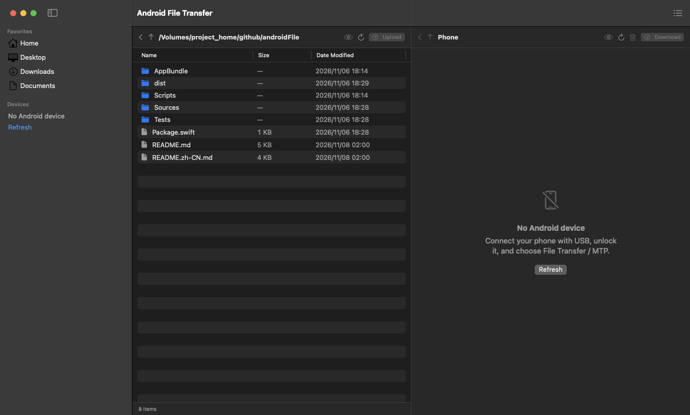
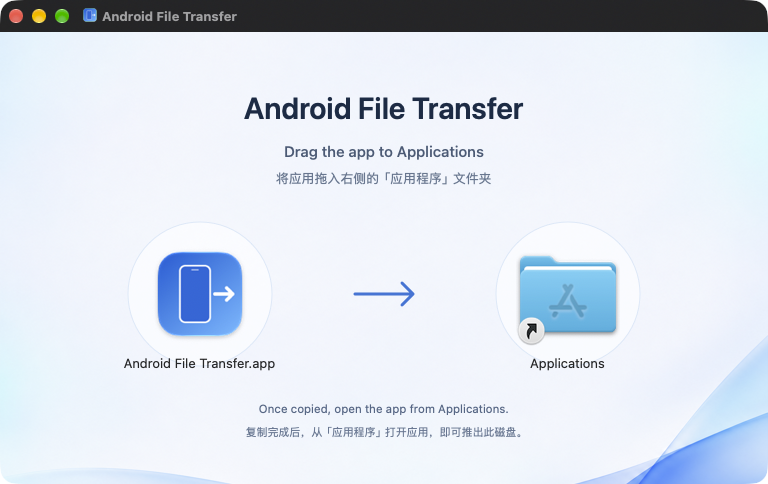
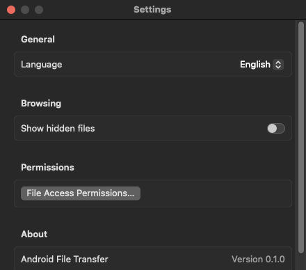

# Android File Transfer

**English** · [简体中文](README.zh-CN.md)

Browse your Android phone from your Mac, move files in either direction, and manage transfers in one native window.

Built with Swift and SwiftUI for **macOS 15 and later**. The app communicates over USB using MTP through Apple's IOUSBHost framework. File transfer requires neither ADB nor USB debugging.



*The current interface in English, browsing this repository. No Android device is connected in this screenshot.*

[Release downloads](https://github.com/umbrella22/Android-File-Transfer/releases) · [Build from source](#build-from-source) · [Report an issue](https://github.com/umbrella22/Android-File-Transfer/issues)

## What it does

| | Capabilities |
| --- | --- |
| Browse | Side-by-side Mac and phone panes, folder navigation, internal storage and device-exposed SD cards or storage categories. |
| Transfer | Upload and download files or entire folders, with recursive progress and a persistent job queue. |
| Manage | Pause, resume, cancel, and retry jobs. Resolve name conflicts by replacing, keeping both, or canceling. Delete selected phone files and folders. |
| Preview | Quick Look for local files and phone files. Phone previews are downloaded to a local cache first. |
| Work with Finder | Drop Finder files and folders into the phone pane to upload. Drag a phone file or folder out to Finder to download. |
| Make it yours | Switch between English and Simplified Chinese, show hidden local files, and open the file-access permission guide from Settings. |

## Connect and transfer

1. Download `Android-File-Transfer-macOS-universal.dmg` from a tagged [Release](https://github.com/umbrella22/Android-File-Transfer/releases), when available. Open the disk image and drag **Android File Transfer** onto the **Applications** folder in the installer window. The universal build includes Apple Silicon and Intel support.
2. Open **Android File Transfer** from Applications on the Mac's internal disk, then eject the installer disk. Builds currently use ad-hoc signing and are not notarized. If macOS blocks a downloaded copy that you trust, use **System Settings → Privacy & Security → Open Anyway** when that option is available.
3. Connect the phone with a USB data cable, unlock it, and select **File Transfer / MTP** in its USB settings.
4. Select a phone storage in the sidebar. Browse a local folder on the left and a phone folder on the right, then upload or download your selection.

Tagged release packages also include `SHA256SUMS`. To verify a downloaded DMG, place both files in the same folder and run:

```sh
shasum -a 256 -c SHA256SUMS
```



*Open the DMG, then drag the app onto Applications.*

### Everyday actions

| Action | How |
| --- | --- |
| Open a folder | Double-click it in either pane. |
| Open a local file | Double-click to open it with its default macOS application. |
| Download a phone file | Double-click it, or select it and choose **Download** (`⌘D`). |
| Upload local items | Select them and choose **Upload** (`⌘U`), or drop files from Finder into the phone pane. |
| Preview a selection | Use the eye button or **Quick Look** in the context menu. |
| View queued transfers | Choose **Transfers** in the toolbar (`⌘J`). |

## Permissions and connection help

Local folder access follows macOS privacy permissions. Allow access when macOS requests it. If access was denied, use **Settings → File Access Permissions…** to open the relevant system settings and check again. Full Disk Access is optional.



- **Phone does not appear:** unlock it, check that the cable supports data, choose File Transfer / MTP, and use Refresh.
- **MTP interface is busy:** close other MTP clients and apps using the phone, such as Image Capture or Photos, then reconnect.
- **A local folder is inaccessible:** check Files and Folders permissions. Run the app from the internal disk; launching it from a removable volume can introduce additional privacy prompts.

## Build from source

Development requires **Xcode 26 or later with a Swift 6 toolchain**. The Swift package contains the app, protocol implementation, and tests, with no third-party package dependencies.

```sh
git clone https://github.com/umbrella22/Android-File-Transfer.git
cd Android-File-Transfer

swift test
./Scripts/build-app.sh debug --install
open "$HOME/Applications/Android File Transfer.app"
```

The build script assembles the executable, icon, and localized bundle metadata, applies an ad-hoc signature, and writes `dist/Android File Transfer.app`. `--install` copies it to `~/Applications`.

For a universal release build:

```sh
./Scripts/build-app.sh release --universal
```

`--install` and `--universal` can be combined.

To package the universal app as a drag-to-install DMG, install Python 3.10 or later and run:

```sh
./Scripts/build-dmg.sh
```

The script installs pinned packaging dependencies into `.build/dmg-tools`, creates the DMG with its bilingual background and Applications shortcut, then mounts it read-only to verify the layout, both executable architectures, and the app's signature after copying it out. It writes `dist/Android-File-Transfer-macOS-universal.dmg`. Packaging runs without Finder automation or an image-generation API call.

## Publish a release

Update `CFBundleShortVersionString` and `CFBundleVersion` in [AppBundle/Info.plist](AppBundle/Info.plist), then commit and push the release changes. Push a tag to start the [release workflow](.github/workflows/release.yml):

```sh
git tag v0.1.0
git push origin v0.1.0
```

Every pushed tag triggers the workflow. It uses Xcode 26.3 on macOS 15 to run tests, build the universal app, and create and verify the drag-to-install DMG. It then publishes a GitHub Release with generated notes and these attachments:

- `Android-File-Transfer-macOS-universal.dmg`
- `SHA256SUMS`

Authentication uses the built-in `GITHUB_TOKEN`; no additional secrets are required. Rerunning the workflow replaces same-named assets on an existing release. The tag identifies the release; it does not rewrite the version inside the app.

To rebuild an existing tag, open **Actions → Release → Run workflow** and enter the tag in the `tag` field. This checks out the tagged source and publishes to that tag's release, using the workflow from the selected branch.

## Inside the project

| Location | Responsibility |
| --- | --- |
| [Sources/AndroidFileTransferApp](Sources/AndroidFileTransferApp) | SwiftUI windows, browsing, Quick Look, localization, and the persistent transfer queue. |
| [Sources/AndroidFileTransferKit/PTP](Sources/AndroidFileTransferKit/PTP) | PTP containers, datasets, and string encoding. |
| [Sources/AndroidFileTransferKit/USB](Sources/AndroidFileTransferKit/USB) | USB interface discovery and IOUSBHost transport. |
| [Sources/AndroidFileTransferKit/MTP](Sources/AndroidFileTransferKit/MTP) | MTP sessions and file operations; transactions pass through a serialized session gate. |
| [AppBundle](AppBundle) | App metadata, icon, and localized bundle resources. |
| [AppBundle/DMG](AppBundle/DMG) | Installer artwork, bilingual background, and Finder layout. |
| [Scripts/build-dmg.sh](Scripts/build-dmg.sh) | DMG packaging and mounted-image verification. |
| [Tests/AndroidFileTransferKitTests](Tests/AndroidFileTransferKitTests) | Codec, dataset, and mock-transport session tests. |

`swift test` checks protocol behavior without a phone. Device compatibility, unplugging during transfers, and sleep/wake behavior require separate hardware testing.

## Current limits

- Resume restarts the current job from the beginning; transfers do not resume at a byte offset.
- Dragging out to Finder supports one phone file or folder at a time. Use the Download action for multiple selected items.
- Symbolic links are not uploaded as links; recursive folder uploads skip them.
- Installing APK, APKS, APKM, or XAPK packages is not implemented. These files can be transferred like other files.
- English and Simplified Chinese are the available interface languages.
- Developer ID signing, notarization, and App Store distribution are not configured.

This is an independent project and is not affiliated with Google's Android File Transfer app.
