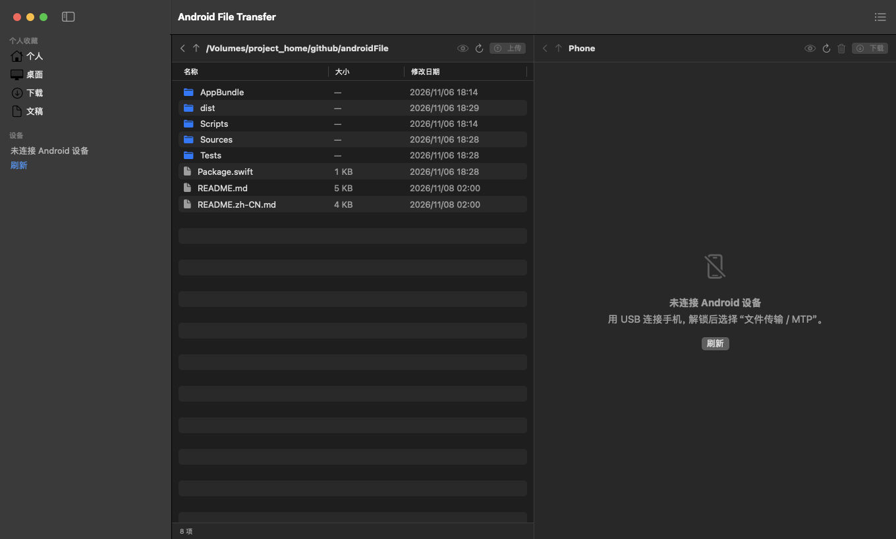
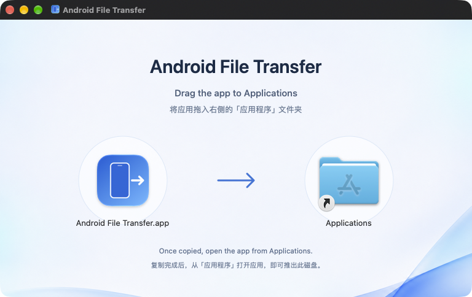
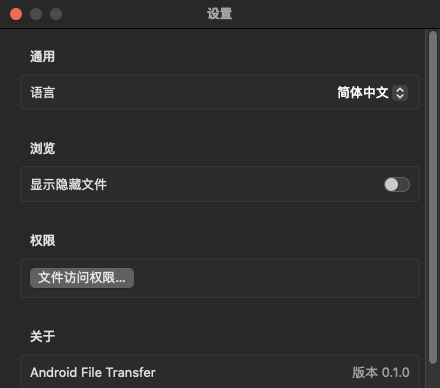

# Android File Transfer

[English](README.md) · **简体中文**

在 Mac 上浏览 Android 手机，把文件传到手机、下载回电脑，并在一个原生窗口里管理传输任务。

使用 Swift 和 SwiftUI 构建，支持 **macOS 15 及以上版本**。应用通过 Apple IOUSBHost 框架直接使用 USB MTP 协议传输文件，日常文件传输无需 ADB，也无需开启 USB 调试。



*当前中文界面，本地面板正在浏览本仓库。截图时未连接 Android 设备。*

[下载发布版本](https://github.com/umbrella22/Android-File-Transfer/releases) · [从源码构建](#从源码构建) · [反馈问题](https://github.com/umbrella22/Android-File-Transfer/issues)

## 可以做什么

| | 功能 |
| --- | --- |
| 浏览文件 | Mac 与手机双栏浏览、文件夹导航，访问手机公开的内部存储、SD 卡及分类存储。 |
| 双向传输 | 上传或下载文件与整个文件夹，显示递归进度，并将任务保存到持久化队列。 |
| 管理任务 | 暂停、继续、取消和重试；重名时选择替换、保留两者或取消；批量删除手机文件与文件夹。 |
| 快速预览 | 使用 Quick Look 预览本地文件或手机文件；手机文件会先下载到本地缓存。 |
| 配合 Finder | 把 Finder 中的文件或文件夹拖入手机面板上传，也可以把手机文件或文件夹拖到 Finder 下载。 |
| 偏好设置 | 随时切换中英文、显示本地隐藏文件，并从设置打开文件访问权限引导。 |

## 连接并开始传输

1. 有发布构建时，从 [Releases](https://github.com/umbrella22/Android-File-Transfer/releases) 下载 `Android-File-Transfer-macOS-universal.dmg`。打开磁盘映像，将窗口左侧的 **Android File Transfer** 拖到右侧的 **Applications（应用程序）** 文件夹。通用版同时包含 Apple Silicon 和 Intel 支持。
2. 从 Mac 内置磁盘的“应用程序”目录打开 **Android File Transfer**，然后推出安装磁盘。当前构建使用 ad-hoc 签名，尚未公证。如果 macOS 拦截了你信任的下载副本，可在系统提供该选项时，前往 **系统设置 → 隐私与安全性 → 仍要打开**。
3. 用支持数据传输的 USB 线连接手机，解锁手机，在 USB 设置中选择 **文件传输 / MTP**。
4. 在侧边栏选择手机存储。左侧进入本地目录，右侧进入手机目录，再上传或下载选中的项目。

按 tag 发布的附件还包含 `SHA256SUMS`。把它与下载的 DMG 放在同一个目录，即可校验文件：

```sh
shasum -a 256 -c SHA256SUMS
```



*打开 DMG，将应用拖入右侧的 Applications，即可复制安装。*

### 常用操作

| 操作 | 使用方式 |
| --- | --- |
| 打开文件夹 | 在任一面板双击文件夹。 |
| 打开本地文件 | 双击后交给 macOS 默认应用打开。 |
| 下载手机文件 | 双击文件，或选中后点击“下载”（`⌘D`）。 |
| 上传本地项目 | 选中后点击“上传”（`⌘U`），或从 Finder 拖入手机面板。 |
| 预览选中项 | 点击眼睛按钮，或使用右键菜单中的 Quick Look。 |
| 查看传输队列 | 点击工具栏中的“传输队列”（`⌘J`）。 |

## 权限与连接问题

本地目录访问遵循 macOS 隐私权限。系统询问时允许访问即可；如果之前拒绝过，可从 **设置 → 文件访问权限…** 打开对应的系统设置，授权后重新检查。完全磁盘访问权限是可选项。



- **看不到手机：** 解锁手机，确认数据线支持传输，选择“文件传输 / MTP”，然后刷新。
- **提示 MTP 接口被占用：** 关闭其他 MTP 客户端，以及正在访问手机的“图像捕捉”“照片”等应用，再重新连接。
- **无法访问本地目录：** 检查“文件与文件夹”权限。建议从内置磁盘运行应用，直接从移动卷启动可能带来额外的隐私授权提示。

## 从源码构建

开发需要 **Xcode 26 或更高版本，以及 Swift 6 工具链**。Swift package 包含应用、协议实现和测试，没有第三方包依赖。

```sh
git clone https://github.com/umbrella22/Android-File-Transfer.git
cd Android-File-Transfer

swift test
./Scripts/build-app.sh debug --install
open "$HOME/Applications/Android File Transfer.app"
```

构建脚本会组装可执行文件、图标和本地化元数据，进行 ad-hoc 签名，并输出 `dist/Android File Transfer.app`。`--install` 会将应用复制到 `~/Applications`。

构建通用版 Release 应用：

```sh
./Scripts/build-app.sh release --universal
```

`--install` 与 `--universal` 可以组合使用。

将通用版应用打包为支持拖拽安装的 DMG，需要 Python 3.10 或更高版本：

```sh
./Scripts/build-dmg.sh
```

脚本会将固定版本的打包依赖安装到 `.build/dmg-tools`，生成包含中英文背景和 Applications 快捷入口的 DMG，再以只读方式挂载，检查布局、双架构，以及应用复制出来后的签名。产物为 `dist/Android-File-Transfer-macOS-universal.dmg`。打包不依赖 Finder 自动化，也不会调用图像生成接口。

## 发布新版本

更新 [AppBundle/Info.plist](AppBundle/Info.plist) 中的 `CFBundleShortVersionString` 和 `CFBundleVersion`，提交并推送发布相关修改，然后推送 tag，启动[发布流水线](.github/workflows/release.yml)：

```sh
git tag v0.1.0
git push origin v0.1.0
```

所有推送的 tag 都会触发流水线。它在 macOS 15 上使用 Xcode 26.3 运行测试，构建通用版应用，生成并验证拖拽安装 DMG，随后创建带有自动生成发布说明的 GitHub Release，附带：

- `Android-File-Transfer-macOS-universal.dmg`
- `SHA256SUMS`

认证使用内置的 `GITHUB_TOKEN`，无需额外配置 secrets。重新运行流水线会替换已有 Release 中的同名附件。Tag 用于标识发布版本，不会自动改写应用内的版本号。

## 项目结构

| 位置 | 职责 |
| --- | --- |
| [Sources/AndroidFileTransferApp](Sources/AndroidFileTransferApp) | SwiftUI 窗口、文件浏览、Quick Look、本地化与持久化传输队列。 |
| [Sources/AndroidFileTransferKit/PTP](Sources/AndroidFileTransferKit/PTP) | PTP 容器、数据集与字符串编码。 |
| [Sources/AndroidFileTransferKit/USB](Sources/AndroidFileTransferKit/USB) | USB 接口枚举与 IOUSBHost 传输。 |
| [Sources/AndroidFileTransferKit/MTP](Sources/AndroidFileTransferKit/MTP) | MTP 会话与文件操作；事务经过会话内的串行调度。 |
| [AppBundle](AppBundle) | 应用元数据、图标与本地化 bundle 资源。 |
| [AppBundle/DMG](AppBundle/DMG) | 安装背景素材、中英文排版与 Finder 布局。 |
| [Scripts/build-dmg.sh](Scripts/build-dmg.sh) | DMG 打包与挂载验证。 |
| [Tests/AndroidFileTransferKitTests](Tests/AndroidFileTransferKitTests) | 编解码、数据集与模拟传输层会话测试。 |

`swift test` 无需连接手机，用于验证协议行为。设备兼容性、传输中拔插与睡眠唤醒需要单独进行真机测试。

## 当前限制

- 继续任务会从头执行当前任务，不支持按字节偏移续传。
- 从手机拖到 Finder 一次支持一个文件或文件夹；多选项目可使用“下载”。
- 符号链接不会作为链接上传，递归上传文件夹时会跳过符号链接。
- 尚未实现 APK、APKS、APKM、XAPK 安装，这些文件目前可以作为普通文件传输。
- 界面语言目前提供英文与简体中文。
- 尚未配置 Developer ID 签名、公证与 App Store 分发。

本项目为独立实现，与 Google 的 Android File Transfer 应用无关联。
